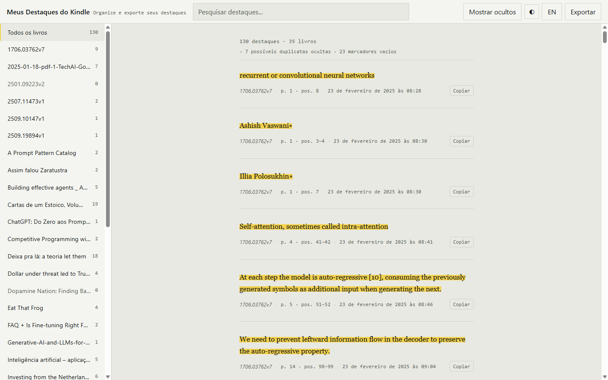

# Kindle Clippings Reader

Reads a Kindle `My Clippings.txt` file and turns that ever-appended wall of text — full of
duplicates and invisible characters — into something searchable, clean, and exportable.

**Nothing leaves the device**, with one opt-in exception. The file is read by the browser itself
(`FileReader`), never sent to any server. No build, no dependencies, no external requests — not even
fonts — until you flip the OFF-by-default *Load covers* switch, which sends each book's title and
author (never highlight text) to openlibrary.org for a cover and a subject.



## The problem it solves

A Kindle logs every highlight, note, and bookmark into a single text file that:

- is **append-only** — grows forever, in no useful order;
- carries a **BOM (`U+FEFF`) in the middle of the file**, not just at the start, which splits a
  single book into two;
- accumulates **"extended highlights"**: every time you drag the selection further, a new, larger
  copy gets written;
- mixes **NFC and NFD** — the same word in Portuguese exists in two different byte forms, so search
  and deduplication simply don't work without normalizing first;
- glues the `<You have reached the clipping limit for this item>` warning **into the middle of the
  real text**.

## What it does

- **Cleans by default, never deletes.** Likely duplicates are hidden behind a button; the original
  record stays intact in memory and reappears when you turn on *Show hidden*.
- **Invisible hashtag per book.** Every highlight carries a `#PascalCase` tag that never shows on
  screen, but travels along on copy (plain selection **or** the Copy button) and in every export —
  highlights land in Obsidian/Notion already tagged.
- **Portuguese is a first-class language.** UI defaults to pt-BR, search ignores accents (`acao`
  matches `ação`), sorting uses pt-BR `localeCompare`, dates and numbers go through `Intl`. A button
  switches to English; the hashtag itself is never translated.
- **Notes stick to the right highlight.** Kindle writes a highlight and its note in the same second,
  so matching goes by *identical timestamp* first, position containment second, proximity last.
- **Exports** to Markdown (with frontmatter and `tags:`), JSON, CSV, TXT, and TSV for Anki.
- **Opt-in covers and topics.** A single switch fetches each book's cover and Open Library subjects,
  classified into a fixed 15-topic taxonomy. Only the cover *URL* and the subjects are cached in
  `localStorage`, never the image bytes, so a large library never hits the storage quota. Candidates
  are title-checked before they are trusted, and sideloaded PDFs and saved web pages are recognised
  and never looked up. Books with no fetched cover get a generated SVG placeholder in their topic
  color, so the library looks designed from the first load, before you ever flip the switch.
- **A shelf page** (`shelf.html`) shows every known book as a cover card — searchable, filterable by
  topic, click through to reopen that book in the reader. It fills in missing covers itself when the
  switch is on.
- **Sort the reading pane** by file order, newest/oldest, book, or topic (with sticky group headers);
  **sort the book list** by title, highlight count, or most recently highlighted; **resize the
  sidebar** by dragging or with the arrow keys.

## Usage

Open `index.html` with a double-click and drag your `My Clippings.txt` onto the page. That's it.

To serve it on the LAN (mini-PC, Portainer, port 8099), see [`deploy/DEPLOY.md`](deploy/DEPLOY.md).

Shortcuts: `/` focuses search, `Esc` closes the menu and the book drawer.

## Architecture

No bundler, no ES modules, no build. Each file is an IIFE hanging off `window.KC`, loaded via a
plain `<script src>` tag — works the same over `file://` and behind nginx.

| File | Role |
|---|---|
| `js/i18n.js` | pt-BR/en catalogs, accent-free `fold()`, `Intl` formatters |
| `js/store.js` | localStorage prefs + library cache, sessionStorage raw-text cache |
| `js/topics.js` | fixed 15-topic taxonomy, Open Library subject classifier |
| `js/parser.js` | raw text → records (`KC.parse`) |
| `js/dedupe.js` | union-find over position overlap + text containment |
| `js/clean.js` | normalization, filters, note association (`KC.clean.process`) |
| `js/tags.js` | book → `#Hashtag` |
| `js/search.js` | tokenized, accent-insensitive search |
| `js/sort.js` | right-pane ordering (date/book/topic) + group-key assignment |
| `js/covers.js` | opt-in Open Library fetch queue, SVG placeholder covers |
| `js/exports.js` | md / json / csv / txt / anki + download |
| `js/clipboard.js` | `copy` event interception + per-card copy button |
| `js/cards.js` | single card render + `IntersectionObserver` pagination |
| `js/sidebar.js` | sidebar render (sort control, topic chips, book rows), drag resizer |
| `js/ui.js` | chrome render — book banner, sort bar, stat line, toast |
| `js/app.js` | state, file loading, drag & drop, wiring |
| `shelf.html` / `js/shelf.js` | standalone cover-shelf page |

Three details that are easy to get wrong and are handled on purpose:

- the `IntersectionObserver`'s `root` is **the scrolling panel**, not the viewport — with
  `root: null` in this two-pane layout the sentinel never fires (or fires immediately);
- the pagination reset key is `activeBook | activeTopic | query | showHidden | sortMode` — **all five**;
- all DOM built from the file's content uses `createElement` + `textContent`, never `innerHTML`.

## Tests

```powershell
node tests/parser.test.js
```

165 assertions: a synthetic fixture covering every edge case (mid-file BOM, nested parentheses,
authorless document, highlight/bookmark/note in pt-BR, unknown locale, empty bookmark, clipping
limit glued into the text, exact duplicate, A⊂B⊂C chain, 12-hour US date, NBSP / typographic quotes
/ optional hyphen), the topic classifier and taxonomy shape, the sort/group logic — plus a regression
run against the real `My Clippings.txt`.

The real file is personal and is in `.gitignore`; that part of the suite skips itself when it's
not present.

For anyone editing the code (human or agent), [`CLAUDE.md`](CLAUDE.md) has the architecture map
and the easy-to-break details underneath it.

## Out of scope for now

List virtualization, hand-editing topics, ISBN/Google Books cover fallback, and persisting highlight
text itself in `localStorage` (only the session-scoped raw file text is cached) are left for later.
